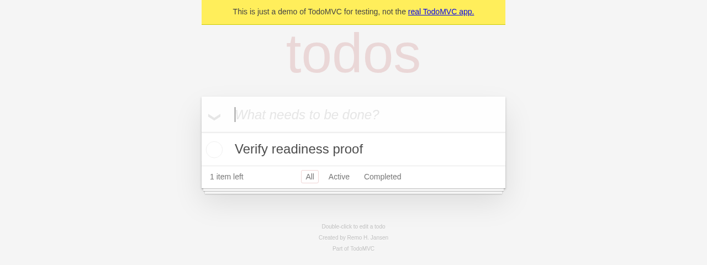

<div align="center">

<p><a href="https://revyl.com"><strong>REVYL</strong></a></p>

# Verify

Drive cloud browsers, iOS simulators and Android emulators from code,<br>with plain-English instructions and validations.

[](https://www.npmjs.com/package/@revyl/verify) [](https://github.com/RevylAI/verify/actions/workflows/ci.yml) [](LICENSE) [](https://pkg.go.dev/github.com/RevylAI/verify/go)

[Documentation](packages/verify/docs/) · [Live evidence](packages/verify/docs/end-to-end.md) · [Examples](examples/)

</div>



<p align="center"><sub>Cropped from a passing TypeScript run on 2026-10-27. <a href="packages/verify/docs/end-to-end.md">See the revision, outcomes and limitations.</a></sub></p>

## Why Verify

- **One library, wherever you work.** Run it from scripts, CI jobs and coding-agent loops.
- **Evidence you can inspect.** Get screenshots and session reports, with recordings when available.
- **No test-runner lock-in.** Use plain code or the test framework you already have; failed validations throw.
- **TypeScript and Go.** Use natural-language steps on web/mobile, or structured commands and files on computers.

## Start in TypeScript

You need **Node.js ≥22.18**, a Revyl account, and an uploaded app or an app already installed on the device. `revyl auth login` requires the Revyl CLI; alternatively, supply `REVYL_API_KEY` through your secret manager.

```bash
npm install --save-dev @revyl/verify
npx @revyl/verify init --platform ios
revyl auth login
```

For this iOS Settings example, replace the generated `app` block in `verify.config.ts` with `app: { bundleId: 'com.apple.Preferences' }`. Put this in `verify/example.ts` and run `node verify/example.ts`. For your own app, set `app.appId` and adapt the steps:

```ts
import { open } from '@revyl/verify';
const session = await open('ios');
try {
  await session.instruction('Open General, then About');
  await session.validation('The screen shows the operating system version');
} finally {
  await session.close();
}
```

For web, run `npx @revyl/verify init --platform web` and configure your Revyl web app ID and public HTTPS URL. [Full setup →](packages/verify/docs/getting-started.md)

<details>
<summary><strong>Prefer Go?</strong> The same workflow, with contexts and typed errors.</summary>

Use **Go ≥1.26.9**. In your Go module:

```bash
go get github.com/RevylAI/verify/go@main
revyl auth login
```

There is no Go release tag yet. `@main` resolves to a pseudo-version; keep the generated `go.mod` and `go.sum` to pin it. Go tags are independent of npm versions.

Inside a function returning `error`, with a bounded `ctx` and imports for `context`, `time`, and `verify "github.com/RevylAI/verify/go"`:

```go
session, err := verify.Open(ctx, verify.Target{Platform: verify.IOS, BundleID: "com.apple.Preferences"})
if err != nil {
    return err
}
defer func() {
    cleanup, cancel := context.WithTimeout(context.Background(), 30*time.Second)
    defer cancel()
    _ = session.Close(cleanup)
}()
if _, err := session.Instruction(ctx, "Open General, then About"); err != nil {
    return err
}
_, err = session.Validation(ctx, "The screen shows the operating system version")
return err
```

This short sketch ignores cleanup errors; the [complete Go examples](go/README.md) handle them. Go uses only the standard library and never installs process-exit handlers.

</details>

### Authentication and versions

Both SDKs use the same order: a usable stored CLI login marked `local_auth_override`, then `REVYL_API_KEY`, then another usable CLI login. An expired access token can fall back to its stored API key. Use a secret manager for environment keys; never put them in scripts or screenshots. [Configuration →](packages/verify/docs/configuration.md)

This source documents **TypeScript 0.2.0 preparation**, not a publication announcement; the npm badge shows the published version. Linux targets, computer `recording()` and `expiresAt` are new in 0.2.0 and absent from 0.1.0. For older installations, use their bundled `docs/`.

## Choose your platform

Both SDKs share these capabilities. Screenshots are PNGs; instruction/validation steps run Revyl's agent on the live session every time, without a step cache or replay.

| Platform | Instructions & validations | Commands, files & processes | Screenshot | Availability |
| --- | :---: | :---: | :---: | --- |
| Web · cloud browser | Yes | — | Yes | Production; requires web-step support on the selected backend |
| iOS · simulator | Yes | — | Yes | Production |
| Android · emulator | Yes | — | Yes | Production |
| Mac · cloud computer | — | Yes | Yes | Early access on staging for enabled organizations; **not in production** |
| Linux · cloud computer | — | Yes | Yes | Early access on staging for enabled organizations/OSes; **not in production** |

For Mac, `npx @revyl/verify init --platform mac` generates a command/file example. Linux init is intentionally unavailable; use `open({ platform: 'linux' })` or a config target. Ask Revyl for the approved `REVYL_BACKEND_URL`, matching `REVYL_APP_URL` and credentials. Computers have a hard 60-minute lifetime from create. [Computer setup and limits →](packages/verify/docs/computers.md)

### Know what “ready” and “passed” mean

Mobile startup makes a bounded, best-effort blank-frame observation, **not** a foreground/rendered-readiness guarantee. Begin with an instruction that reaches your intended screen. Computer capture retries structured startup screen-not-ready responses within a fixed 30-second window; Linux retry behavior is covered by tests, not a completed live retry proof.

Read validation verdicts, not just transport-success counters: the SDK's `passed` and the report's `effective_status` / `validation_result` carry the outcome. Reports and optional recordings are accessible through the session's viewer link. [What has actually run →](packages/verify/docs/end-to-end.md)

Always close in `try/finally` or with a fresh, bounded Go cleanup context. TypeScript process cleanup is best effort, bounded to 15 seconds, and skips signal/error handlers that already have listeners. Device close acknowledges a stop request; computer close requires terminal state and confirmed release. [API and cleanup →](packages/verify/docs/api.md)

## Explore

| Learn | Build |
| --- | --- |
| [Getting started](packages/verify/docs/getting-started.md) · [API](packages/verify/docs/api.md) | [Web store](examples/web-store/) · [Mobile Settings](examples/mobile-settings/) |
| [Web](packages/verify/docs/web.md) · [Mobile](packages/verify/docs/mobile.md) · [Computers](packages/verify/docs/computers.md) | [Mac workspace](examples/mac-workspace/) |
| [CI integration](packages/verify/docs/ci.md) · [Coding agents](packages/verify/docs/agents.md) | [Go SDK and examples](go/README.md) |
| [End-to-end evidence](packages/verify/docs/end-to-end.md) · [Error codes](packages/verify/docs/errors.md) | [Contributing](CONTRIBUTING.md) · [Security](SECURITY.md) · [Releasing](RELEASING.md) |

## License

[Apache 2.0](LICENSE). Built on [Revyl](https://revyl.com).
