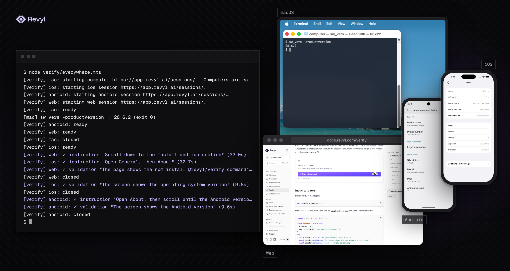

# Verify



Verify runs end-to-end checks in a cloud browser, iOS simulator, or Android emulator on Revyl. You write what the agent should do and what must be true afterward, in plain sentences, and call it from a script, a coding agent, CI, or the test runner you already use. When you know exactly what to press, you can tap, type and swipe yourself instead. Verify also opens Mac computers for commands, files, and screenshots.

```ts
import { open } from '@revyl/verify';

const session = await open({ platform: 'ios', app: { bundleId: 'com.apple.Preferences' } });
try {
  await session.instruction('Open General, then About');
  await session.validation('The screen shows the operating system version');
  await session.screenshot({ path: '.verify/about.png' });
} finally {
  await session.close();
}
```

You maintain sentences instead of selectors and coordinates that break when a screen changes, and every run prints a session link that keeps the report and available recording after the session closes.

## Quick start

Paste this prompt into your coding agent, and it sets up Verify in the project's language:

```text
Set up Verify in this project.

Read https://docs.revyl.com/verify.md and follow it. It's the current Revyl guide for this, so prefer it over anything you remember about Revyl.

Use the SDK for this project's language: @revyl/verify on Node.js 22.18 or later for Node.js or TypeScript, revyl-verify on Python 3.10 or later for Python (install it with pip or uv), or the github.com/RevylAI/verify/go module for Go. Write the iOS Settings example in that language: open the com.apple.Preferences bundle, run one instruction, and run one validation that checks the operating system version. Ask before starting a paid cloud session, then run the example.

You're done when the example has opened iOS Settings, the operating system version validation has passed, and the session has closed.

Ask me before anything that needs my login or approval.
```

Or set it up yourself:

```bash
npx @revyl/verify init
```

`init` adds Verify to your project, asks what to open, writes `verify.config.ts` and an example script, signs you in through the browser on the first interactive run, and prints the command that runs the example. With no app id, the iOS and Android examples open the built-in Settings app, so they run on a new account before you upload anything. To skip the config, run `npm install @revyl/verify` and save the example above as `verify/check.mts`, then run `node verify/check.mts`. [Getting started](packages/verify/docs/getting-started.md) covers sign-in, your own app, and [CI](packages/verify/docs/ci.md).

For finished projects, see [`examples/`](examples/): a [web store](examples/web-store/), [mobile Settings](examples/mobile-settings/), a [Mac workspace](examples/mac-workspace/), a small [agent platform](examples/agent-platform/) that runs web and iOS side by side, and [your own model](examples/byo-model/) (with [Python](python/examples/byo_model.py) and [Go](go/examples/byomodel/main.go) versions).

## Exact actions

Tap, type, swipe and press keys yourself, by a description Revyl locates on screen or by coordinates, in the same script as your steps:

```ts
await session.type({ target: 'Email field' }, 'demo@example.com');   // Revyl finds the element you describe
await session.pressKey('enter');
await session.swipe('up');                                            // scrolls the content down
await session.tap({ x: 196, y: 640 });                                // or device coordinates
await session.instruction('Accept the terms if they are shown');      // the agent where it's fuzzy
await session.validation('The welcome screen is shown');
```

`back`, `openUrl`, `launchApp`, `locate` and `screenSize` round them out; [which call works where](#which-call-works-where) shows the platform limits. Early access. In TypeScript (`@revyl/verify` 0.4.0), Python (`revyl-verify` 0.2.0) and Go (v0.3.0); the [Python](https://github.com/RevylAI/verify/blob/v0.4.0/python/README.md#exact-actions) and [Go](https://github.com/RevylAI/verify/blob/v0.4.0/go/README.md#exact-actions) READMEs show them with each language's names. The [web](packages/verify/docs/web.md#exact-actions) and [mobile](packages/verify/docs/mobile.md#exact-actions) guides have runnable scripts, and [api.md](packages/verify/docs/api.md#exact-actions) lists every call.

## Your own model

Steps run on Revyl's agent unless you pass a model. Then the agent loop runs on your machine with your key, and Revyl provides the device and finds the elements your model names:

```ts
const session = await open('ios', { model: 'anthropic/claude-sonnet-5-5' });       // key from ANTHROPIC_API_KEY
await session.instruction('Open General, then About');
await session.instruction('Open Privacy', { model: 'openai/gpt-5.5' });              // or per step

await open('ios', { model: { id: 'qwen-3.8-27b', baseURL: 'https://api.cerebras.ai/v1', apiKey: process.env.CEREBRAS_API_KEY } });
```

In TypeScript (`@revyl/verify` 0.4.0), Python (`revyl-verify` 0.2.0) and Go (v0.3.0); the [Python](https://github.com/RevylAI/verify/blob/v0.4.0/python/README.md#your-own-model) and [Go](https://github.com/RevylAI/verify/blob/v0.4.0/go/README.md#your-own-model) READMEs show them with each language's names. Built in: `anthropic`, `openai`, `google`, `openrouter`, `groq`, `cerebras`, `xai` and `ollama`; anything OpenAI-compatible works through `baseURL`. Early access; [Use your own model](packages/verify/docs/own-model.md) covers the providers, picking a model, what Revyl still sees, limits and troubleshooting.

## Packages

| Package | Install | Status |
| --- | --- | --- |
| [`@revyl/verify`](https://www.npmjs.com/package/@revyl/verify) | `npm install @revyl/verify` | TypeScript SDK and the `verify` CLI (`init`, `login`, `logout`, `whoami`). Published on npm, Node.js 22.18 or later. |
| [`revyl-verify`](https://www.npmjs.com/package/revyl-verify) (npm) | `npm install revyl-verify` | Alias of `@revyl/verify` at the same version. |
| [Go module](https://github.com/RevylAI/verify/tree/go/v0.3.0/go) | `go get github.com/RevylAI/verify/go@v0.3.0` | Published as the `go/v0.3.0` tag, Go 1.26.9 or later. Calls return errors instead of throwing. |
| [`revyl-verify`](https://pypi.org/project/revyl-verify/) (PyPI) | `pip install revyl-verify` or `uv add revyl-verify` | Python SDK, published on PyPI. Python 3.10 or later, sync and asyncio APIs, no CLI; see the [Python guide](python/README.md). |

## Platforms

| Platform | Instructions / validations | Exact actions | Commands / files / processes | PNG screenshot |
| --- | :---: | :---: | :---: | :---: |
| Web | Yes | Yes | — | Yes |
| iOS simulator | Yes | Yes | — | Yes |
| Android emulator | Yes | Yes | — | Yes |
| Mac computer | — | — | Yes | Yes |

### Which call works where

| Call | Web | iOS | Android | Mac computer |
| --- | --- | --- | --- | --- |
| `tap`, `type`, `swipe`, `pressKey`, `locate`, `screenSize` | Yes | Yes | Yes | No, use `exec()` and files |
| `back()` | Yes, browser history | No, tap the on-screen back control | Yes, the system back button | No |
| `openUrl(url)` | Yes, loads an http(s) URL in the tab | Yes, a URL or deep link | Yes, a URL or deep link | No |
| `launchApp(bundleId)` | No, use `openUrl` or `navigate` | Yes | Yes | No |
| `navigate(url)` | Yes | No, use `openUrl` | No, use `openUrl` | No |
| `instruction`, `validation`, your own model | Yes | Yes | Yes | No, use `exec()` |
| `screenshot()` | Yes | Yes | Yes | Yes |
| `exec`, files, processes | No, open a Mac computer | No, open a Mac computer | No, open a Mac computer | Yes |

Coordinates are in iOS points, Android pixels and Web CSS pixels, from the top-left corner. A call a platform doesn't support throws `NOT_AVAILABLE_ON_PLATFORM`, and its message names the alternative.

Web is available to every organization. Mac computers are early access and have a server-bounded lifetime; see [computers](packages/verify/docs/computers.md).

## Documentation

The [documentation](packages/verify/docs/) covers the [API](packages/verify/docs/api.md), [configuration](packages/verify/docs/configuration.md), [web](packages/verify/docs/web.md), [mobile](packages/verify/docs/mobile.md), [computers](packages/verify/docs/computers.md), [CI](packages/verify/docs/ci.md), [your own model](packages/verify/docs/own-model.md), [errors and troubleshooting](packages/verify/docs/errors.md), [coding agents](packages/verify/docs/agents.md), and [live end-to-end results](packages/verify/docs/end-to-end.md). The npm package ships these pages in `node_modules/@revyl/verify/docs/`, with an [llms.txt](packages/verify/docs/llms.txt) index, so a coding agent can read the docs for the version you installed. The Revyl docs site has an overview at [docs.revyl.com/verify](https://docs.revyl.com/verify).

## Status

Verify is at 0.x, so APIs can still change between minor releases; the [changelog](CHANGELOG.md) records each release. Mac computers are early access. See [Contributing](CONTRIBUTING.md) and [Releasing](RELEASING.md) to work on Verify.

## License

[Apache 2.0](LICENSE).
